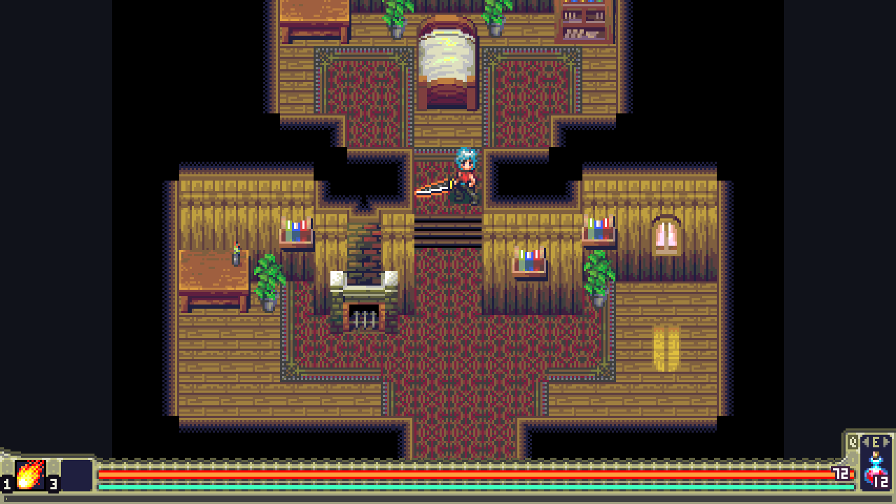
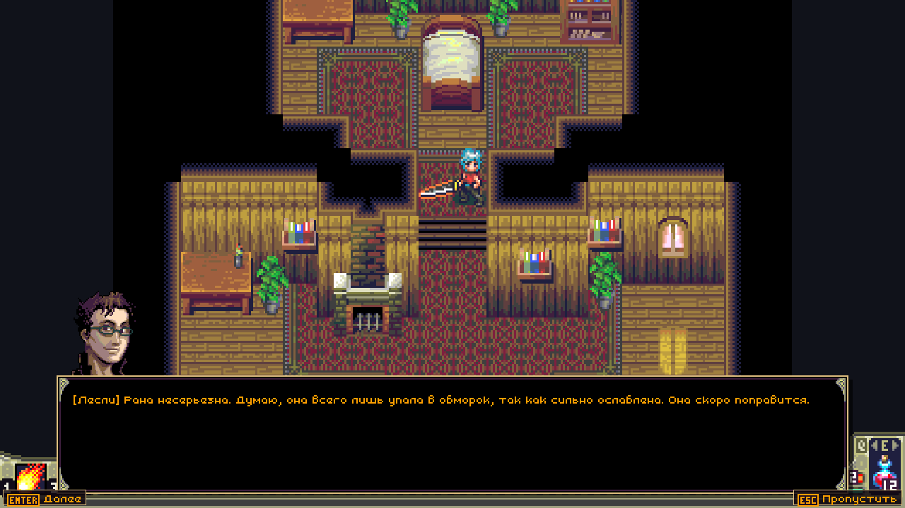
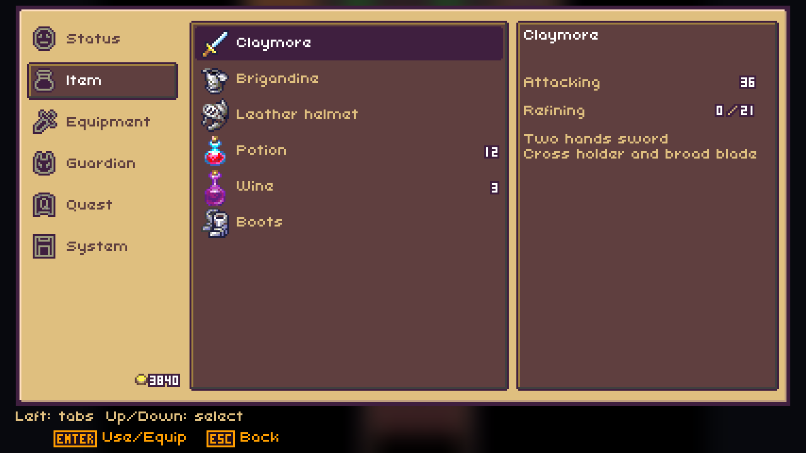
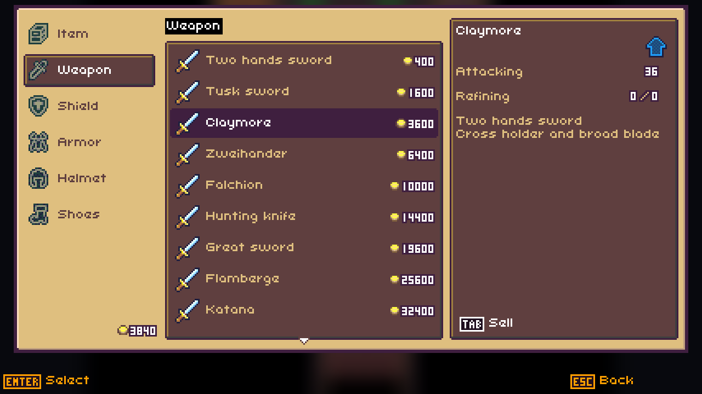
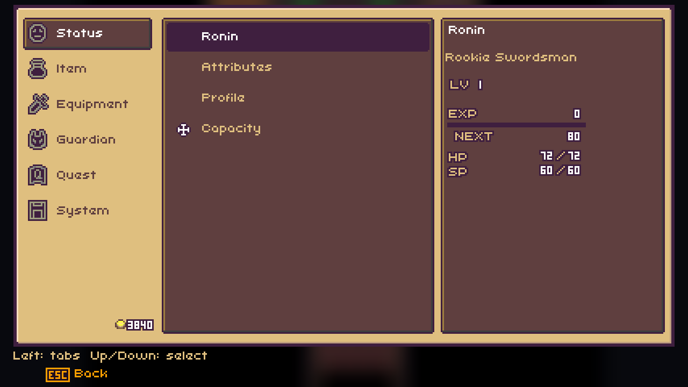
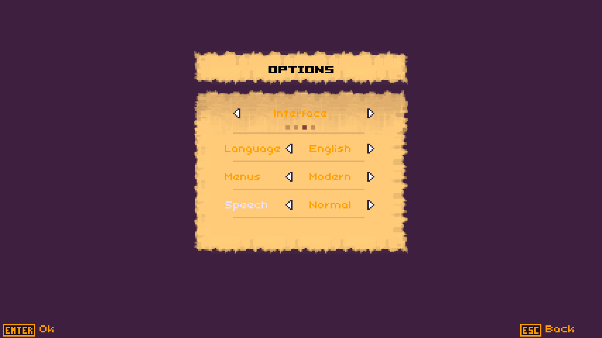

# Heroes Lore: Wind of Soltia

[](https://github.com/Dima353/heroes_lore_decomp/actions/workflows/tests.yml) [](https://github.com/Dima353/heroes_lore_decomp/actions/workflows/windows.yml) [](https://github.com/Dima353/heroes_lore_decomp/actions/workflows/linux.yml) [](https://github.com/Dima353/heroes_lore_decomp/actions/workflows/switch.yml) [](https://github.com/Dima353/heroes_lore_decomp/actions/workflows/3ds.yml) [](https://github.com/Dima353/heroes_lore_decomp/actions/workflows/vita.yml) [](https://github.com/Dima353/heroes_lore_decomp/actions/workflows/psp.yml) [](https://github.com/Dima353/heroes_lore_decomp/actions/workflows/nds.yml) [](https://github.com/Dima353/heroes_lore_decomp/actions/workflows/portmaster.yml)

<p align="center"></p>

## Intro

A decompilation-based native port of the J2ME action RPG Heroes Lore: Wind of Soltia, written in C++17 with SDL2 (Nintendo DS: its own front end on libnds). The game logic was rebuilt from the original bytecode and runs on the original tick rate. The port reads all game resources (maps, sprites, text, music) directly from the original `.jar`, which is not included.

Supported platforms:

| Platform | Release file |
|--|--|
| Windows x64 | `HeroesLore-<version>-Windows-x64.zip` |
| Linux x64 and Steam Deck | `HeroesLore-<version>-Linux-x86_64.AppImage`, `HeroesLore-<version>-Linux-x64.tar.gz` |
| Nintendo Switch | `HeroesLore-<version>-Switch.zip` |
| PlayStation Vita | `HeroesLore-<version>-PSVita.vpk` |
| PlayStation Portable | `HeroesLore-<version>-PSP.zip` |
| Nintendo 3DS | `HeroesLore-<version>-3DS.zip` (`.cia`: build it yourself, [docs/build/3ds-cia.md](docs/build/3ds-cia.md)) |
| Nintendo DS | `HeroesLore-<version>-NDS.zip` |
| PortMaster (ARM64 handhelds) | `HeroesLore-<version>-PortMaster.zip` |

## Installation

- You **must** own the original J2ME game. The port needs its `.jar`; the English release is preferred.
- Build the port (see below), or download a package from [Releases](https://github.com/Dima353/heroes_lore_decomp/releases) or the latest [Actions](https://github.com/Dima353/heroes_lore_decomp/actions) run of your platform.
- Put the `.jar` where the platform expects it:

| Platform | Folder |
|--|--|
| Windows, Linux | next to `heroes_lore` or the `.AppImage` (or drop the `.jar` onto the window) |
| Steam Deck | `~/Games/HeroesLore`, then add the `.AppImage` to Steam as a non-Steam game |
| Switch | `sdmc:/switch/heroeslore/` |
| PlayStation Vita | `ux0:data/heroeslore/` (needs `ur0:data/libshacccg.suprx`) |
| PlayStation Portable | `PSP/GAME/HeroesLore/`, next to `EBOOT.PBP` (custom firmware) |
| 3DS | `sdmc:/3ds/heroeslore/` |
| Nintendo DS | `heroeslore/` next to the `.nds` (or `/heroeslore/` on the SD card), named `Heroes_Lore.jar`; a self-built `.nds` can carry it inside |
| PortMaster | `ports/heroeslore/` |

- Optional: put [GeneralUser GS](https://schristiancollins.com/generaluser.php) (`GeneralUser-GS.sf2`) in the same folder for better music on Windows, Linux, Switch, Vita and PortMaster.

Saves go to `%APPDATA%\HeroesLore` on Windows, `~/.local/share/HeroesLore` on Linux, and to the game folder on consoles.

## Screenshots

<p align="center">





</p>

## Improvements

- Native screen resolution with integer scaling, no blur
- 60 FPS rendering with interpolation, or the original frame rate; game logic stays on the original ticks (3DS and PSP are limited to 30 FPS)
- Gamepad and analog stick support, button icons for keyboard, Xbox, Nintendo and PlayStation
- Menu styles: original, wide and modern
- Music through a SoundFont (GeneralUser GS), with a built-in synthesizer as fallback
- Autosave on entering a location
- Recipe journal collected from dialogue
- Guardian skills on face buttons, triggers kept as an alternative
- Gamepad rumble on damage and screen shake (Switch, desktop), can be turned off
- Russian language option with a Cyrillic font, based on the fan translation of the game
- Platform specific:
  - Switch: larger minimap, HD Rumble
  - PlayStation Vita: overclocking is recommended
  - 3DS: 30 FPS, stereoscopic 3D on the top screen; HUD, minimap, dialogue and touch menus (title menus included) on the bottom screen
  - Nintendo DS: own front end for the original DS (4 MB RAM) at 60 FPS; boss arenas span both screens, HUD, dialogue and touch menus on the bottom screen, music on the DS sound hardware from a GeneralUser GS instrument bank
  - PlayStation Portable: 30 FPS, compressed SoundFont built into the EBOOT

## Building from Source

The source lives in `cpp/` and builds with CMake presets (`cpp/CMakePresets.json`). zlib, minizip and, where needed, SDL2 are downloaded and linked statically by the build.

```bash
git clone https://github.com/Dima353/heroes_lore_decomp.git
```

Step-by-step guides, starting from a clean system:

<details><summary>Windows</summary>

Visual Studio 2022, CMake preset `windows`. See [docs/build/windows.md](docs/build/windows.md).
</details>

<details><summary>Linux and Steam Deck</summary>

Ubuntu 22.04 (native or WSL2), CMake preset `linux`, AppImage through `tools/package_appimage.sh`. See [docs/build/linux.md](docs/build/linux.md).
</details>

<details><summary>Nintendo Switch</summary>

devkitPro (devkitA64, libnx), CMake preset `switch-wsl`. See [docs/build/switch.md](docs/build/switch.md).
</details>

<details><summary>PlayStation Vita</summary>

VitaSDK, CMake preset `vita`. See [docs/build/vita.md](docs/build/vita.md).
</details>

<details><summary>PlayStation Portable</summary>

PSPSDK in Docker, `tools/build_psp.ps1`. See [docs/build/psp.md](docs/build/psp.md).
</details>

<details><summary>Nintendo 3DS</summary>

devkitPro (devkitARM, citro2d), CMake preset `3ds`. See [docs/build/3ds.md](docs/build/3ds.md); for an installable `.cia` see [docs/build/3ds-cia.md](docs/build/3ds-cia.md).
</details>

<details><summary>Nintendo DS</summary>

devkitPro (devkitARM, libnds, calico, nds-zlib), `tools/build_nds.sh`. See [docs/build/nds.md](docs/build/nds.md).
</details>

<details><summary>PortMaster</summary>

aarch64 cross compiler with an Ubuntu 20.04 arm64 sysroot, CMake preset `portmaster`. See [docs/build/portmaster.md](docs/build/portmaster.md).
</details>

> :information_source: **Full build.** Without extra steps a build plays music through the built-in synthesizer. Add `-DHEROES_LORE_FULL_BUILD=ON` to the configure command to download GeneralUser GS and embed the compressed subset (required for good music on PSP and 3DS); it needs Python 3 and ffmpeg and no game files. Details: [docs/build/soundfont.md](docs/build/soundfont.md).

> :information_source: The 3DS icon and banner are in `cpp/dist/3ds/`. Icons and LiveArea art for other platforms are optional: put your own files in `cpp/assets/` (paths are listed in each platform guide); without them the default homebrew icons are used.

### Running tests

Regression tests check the ported game logic (combat, saves, events, shops, menus) against the behaviour of the original. They build without SDL on Linux or WSL:

```bash
sudo apt install -y git build-essential cmake ninja-build
cd cpp
cmake --preset inspect -DHEROES_LORE_BUILD_TESTS=ON -DHEROES_LORE_FETCH_DEPS=ON -DHEROES_LORE_FETCH_SDL=OFF
cmake --build build-inspect
ctest --test-dir build-inspect --output-on-failure
```

## Legal

This project is not affiliated with or endorsed by the owners of Heroes Lore. It contains no game assets: the original `.jar` must be supplied by the player. The code is published for educational, preservation and interoperability purposes only. Do not use it commercially and do not distribute builds with game files included (for example a 3DS `.cia` with a packed `.jar`).

## Credits

- [SDL2](https://www.libsdl.org/), [zlib and minizip](https://zlib.net/)
- [TinySoundFont](https://github.com/schellingb/TinySoundFont) for SoundFont playback
- [GeneralUser GS](https://schristiancollins.com/generaluser.php) by S. Christian Collins
- The unknown authors of the old Russian fan translation (fonts, text and localized images in `cpp/src/language_pack_ru.inc`). If you are one of them, open an issue to be credited by name.
- [devkitPro](https://devkitpro.org/) (libnds, calico, libfat), [VitaSDK](https://vitasdk.org/), [PSPDEV](https://github.com/pspdev), [PortMaster](https://portmaster.games/)
